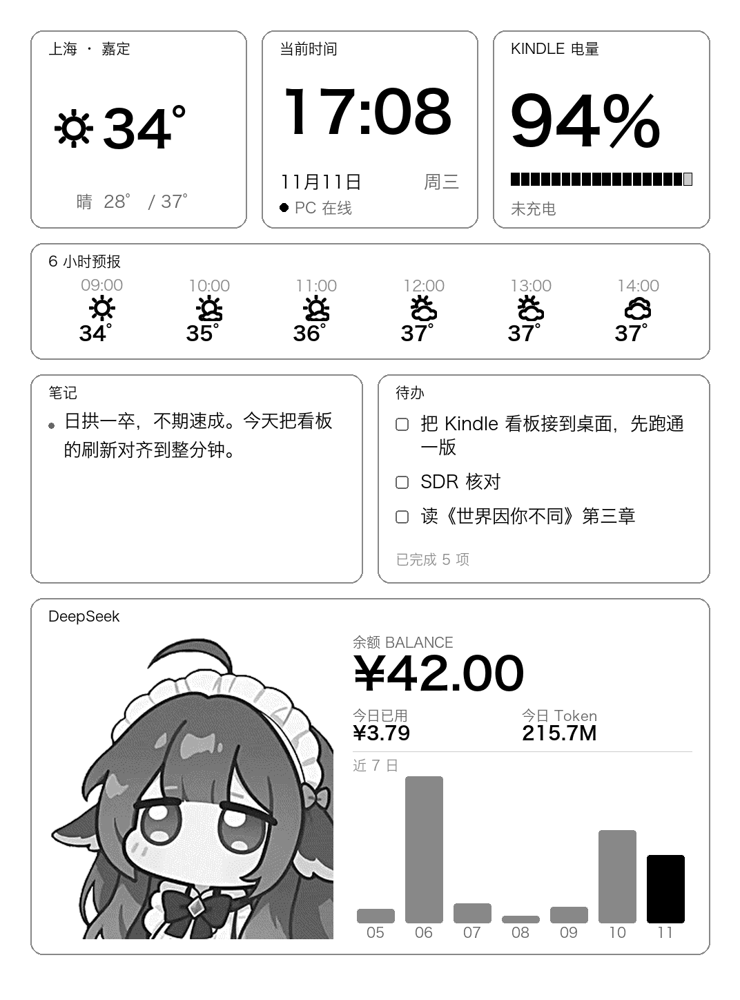

# Kindle Dashboard · Paperwhite 3 改造版

把一台吃灰的 Kindle 变成桌面信息屏：**天气 / 时间 / Kindle 电量 / Obsidian 笔记与待办 / DeepSeek 余额与用量**，全部压在一张 1072×1448 的 16 级灰 PNG 上，每整分钟刷新一次。

> Fork 自 [xyc1994/kindle-dashboard](https://github.com/xyc1994/kindle-dashboard)（MIT）。
> 原版是 Windows + KUAL 方案；本 fork 做了 **macOS 化、日系视觉重做、DeepSeek 用量面板**，并把整条链路在真机（PW3 / 5.15.1.1）上跑通。



---

## 它怎么工作

PC 负责渲染，Kindle 只负责"拉图 + 上屏"：

```
        Mac                                          Kindle
┌────────────────────────┐                  ┌──────────────────────────┐
│ dash_server.py :8765   │◀── HTTP GET ─────│ curl /dash.png?t=<token> │
│   └ build_dashboard.py │                  │   └ eips -g → framebuffer│
│       ├ 天气 (QWeather)│─── 1072×1448 ───▶│                          │
│       ├ Obsidian 笔记  │      灰度 PNG      │ 每 15s 重绘同一帧（保屏）│
│       └ DeepSeek 账本  │                  │ 每次拉图回传一次电量      │
└────────────────────────┘                  └──────────────────────────┘
```

- **PC 每次被请求都重新渲染**，所以屏上的时间、余额永远是新的
- Kindle **不停 framework**，靠每 15 秒把缓存的帧再刷一遍压住原生界面 —— 触屏、原生阅读器随时可用
- 刷新**对齐整分钟**：分钟一跳就拉新图，屏上的"分"和电脑一致（误差 1–2 秒）

---

## 与上游的差异

| 维度 | 上游 xyc1994/kindle-dashboard | 本 fork |
|---|---|---|
| 部署平台 | Windows 盘符（`--drive F:`） | **macOS / POSIX**（`tools/deploy_kindle_macos.py`） |
| 启动方式 | KUAL 扩展 + menu.json | **Scriptlet**（`.sh` 放 `documents/`，书库里直接点） |
| 保屏策略 | 15 秒重绘缓存帧 | 相同，另修了上游 `start.sh` 里误停 framework 的坑 |
| 视觉 | 工业 HUD（编号 L-01、切角、斜纹） | **日系圆角卡片**：2px 浅灰描边、大留白、三档灰 |
| 时间面板 | "最近更新"时刻（含秒） | **当前时间 HH:MM**，整分钟对齐 |
| 天气 | 市级 location | **区级**（如浦东新区）+ 真正的"未来 6 小时" |
| 笔记 / 待办 | `05_Memos` + `01_Daily` + `#kindle` | **Obsidian Apex Dashboard** 的 `dashboard.md` |
| 用量面板 | Codex / MiniMax 配额 | **DeepSeek 余额 + 今日已用 + 今日 Token + 近 7 日** |
| 自动重建 | 进程内 `import`（改代码不生效） | **子进程重建**，改完下一张图就生效 |
| 中文字体 | 只认 Windows 微软雅黑 | 增加 macOS 冬青黑体 / 宋体回退 |
| 亮度 | 启动强制设 24（最亮） | 默认**不接管**，用 Kindle 自己的设置 |

---

## 硬件与系统前提

- **Kindle Paperwhite 3**（2015，4GB，1072×1448 / 300ppi）
- 固件 **5.15.1.1**，越狱用 **WinterBreak2**（`jb.sh v2.6.0`）
- 越狱后自带 KPM + 通用 hotfix，`documents/` 里的 `.sh` 会被索引成"书"（Scriptlet）
- **不需要 KUAL** —— 这也是本 fork 改走 Scriptlet 的原因
- PC 端：macOS / Linux / Windows 均可，Python 3.10+、Pillow

> 越狱有风险，请先备份 `documents/`。不要在越狱完成后恢复出厂设置或升级固件。

### 兼容性：不是所有 Kindle 都一样

本仓库在 **PW3 / 5.15.1.1** 上跑通，脚本本身与机型无关，但**越狱方式、分辨率、能否用 Scriptlet** 都随机型和固件变化，别直接抄别人的版本号。

**越狱方式（按机型 / 固件选）**

| 越狱 | 支持机型 | 固件区间 |
|---|---|---|
| WinterBreak2 | 全系（PW ~ PW6、KT、KOA、KS、CS） | 5.6.1.1 – 5.16.3 |
| WinterBreak | 全系 | 5.6.1.1 – 5.18.0.2 |
| Sanctuary | PW4 / KT4 / KOA3 / PW5 / KT5 / KS / KT6 / PW6 / KS2 / CS | 5.16.4 – 5.18.3 |
| SpringBreak | PW5 / KT5；PW4 / KT4 | 5.18.1 – 5.19.2.0.1；5.18.1 – 5.18.1.1.1 |
| AdBreak | PW4 / KT4 / KOA3 / PW5 / KT5 / KS / KT6 / PW6 | 5.18.1 – 5.18.5.0.1 |
| Shadow | KS / KS2 / CS / PW6 / KT6 | 5.19.4 – 5.19.6 |
| Véra | PW5 / KT5 / KT6 / PW6 / CS / KS / KS2 | 5.17.1 – 5.20.2 |

> 最稳的做法：用 [KindleModding 的 Find my Jailbreak](https://kindlemodding.org/jailbreak-wizard.html)，输入序列号前 8 位 + 当前固件，它会直接告诉你该用哪个。**已经在别人机器上成功的方案，未必适配你的固件。**

**能否用 Scriptlet**

`documents/` 里的 `.sh` 能被识别成"书"，靠的是 WinterBreak 系列自带的通用 hotfix（SH_Integration）：

- WinterBreak / WinterBreak2 / Sanctuary 等新方案 → **直接可用**
- 更早的越狱（LanguageBreak 时代）→ 没有 SH_Integration，得改用 **KUAL 扩展**：把 `kindle_ext/` 里的脚本放进 `extensions/kdashboard/`，再配 `menu.json`
- 固件 ≥ 5.16.3 的机器有 Jobman，可用它托管后台进程（本仓库的 `nohup/setsid` 方案同样可行）

**分辨率**

当前版式按 **1072 × 1448**（PW3 / PW4）设计。换机型要改 `src/dashboard_renderer.py` 顶部的 `WIDTH` / `HEIGHT`，并按比例调整 `MARGIN` / `GAP` 与字号，否则会溢出或留白过多。

| 机型 | 分辨率 |
|---|---|
| PW3 / PW4 / Kindle 11 (KT5) | 1072 × 1448 |
| PW5 | 1236 × 1648 |
| PW6（2024） | 1264 × 1680 |
| Kindle 10 (KT4) | 600 × 800 |
| Scribe | 1860 × 2480 |

**固件升级**

越狱后务必**阻断 OTA**（WinterBreak 系列会自动阻断）。任何升级前先确认目标固件仍在可越狱区间 —— 升级会清掉越狱，且**不能降级**。

---

## 快速开始

### 1. PC 端

```bash
git clone git@github.com:JavierYuht/kindle-dashboard.git && cd kindle-dashboard
python3 -m venv .venv && . .venv/bin/activate
pip install -r requirements.txt        # 只有 Pillow

# 和风天气：控制台「我的项目 → 调用地址」里的专属 Host
export QWEATHER_API_HOST=xxxxxxxxxx.re.qweatherapi.com
export QWEATHER_API_KEY=你的Key

python src/dash_server.py --image samples/preview_home.png --port 8765 --auto-build
```

首次启动会生成访问 token：`~/.dash_server/token`，并把 URL 打在终端里。

也可以把配置写进 `config/weather.json`（已被 `.gitignore` 忽略）：

```json
{
  "api_host": "xxxxxxxxxx.re.qweatherapi.com",
  "api_key": "你的Key",
  "location_id": "101020600",
  "location_name": "上海 · 浦东新区"
}
```

### 2. Kindle 端

USB 连上 Kindle，确认挂载到 `/Volumes/Kindle`：

```bash
python tools/deploy_kindle_macos.py --host 192.168.1.50
```

会写入：

```
/mnt/us/dashboard/{dash.sh,start.sh,stop.sh,diag.sh,server.conf}
/mnt/us/documents/{看板-启动.sh,看板-停止.sh,看板-诊断.sh}
```

拔线后书库里点 **「看板 启动」**，10–20 秒出图。点「看板 停止」恢复原生界面。

### 3. 鲸鱼娘立绘（可选）

立绘来自 DSH 的小鲸鱼挂件，**不随仓库分发**。本地装了插件后自行生成：

```bash
python tools/make_mascot.py     # 裁边 → 灰化 → 16 级 Floyd–Steinberg 抖动
```

没生成时 DeepSeek 面板会退化成纯数字，不会报错。

---

## 配置项（`dashboard/server.conf`）

| 键 | 默认 | 说明 |
|---|---|---|
| `HOST` / `PORT` | 自动探测 / 8765 | PC 地址；留空则靠网段扫描自动发现 |
| `TOKEN` | 部署时自动填 | 与 `~/.dash_server/token` 一致 |
| `DAY_INTERVAL` | `60` | 白天拉图间隔（秒） |
| `NIGHT_INTERVAL` | `60` | 夜间间隔；**调大会让屏上时钟停在该间隔上** |
| `NIGHT_START` / `NIGHT_END` | `1` / `6` | 夜间时段（小时） |
| `FULL_REFRESH_RATE` | `5` | 每 N 次拉图做一次全刷防残影 |
| `APPLY_FL` | `0` | 是否由脚本接管前光；默认用 Kindle 自身设置 |
| `DEF_FL` | `10` | `APPLY_FL=1` 时生效，0–24 |

改完点「看板 停止」→「看板 启动」生效。

---

## 数据来源

| 面板 | 来源 | 备注 |
|---|---|---|
| 天气 | 和风天气 v7 API | 需要专属 API Host；区级 location id |
| 笔记 / 待办 | `~/Obsidian/<vault>/dashboard.md` | Apex Dashboard 的卡片；可用 `APEX_DASHBOARD_PATH` 覆盖 |
| DeepSeek | `~/.dsh/.dshw-usage.json` | 小鲸鱼挂件的本地账本，**不读密钥、不联网** |
| Kindle 电量 | `POST/GET /report?t=&b=&c=` | Kindle 每次拉图后回传 |

笔记只显示**最新的一张备忘卡**（按卡片标题里的日期排序）；待办显示全部未完成项、按卡片从新到旧。

---

## Mac 端常驻

```bash
cp tools/local.kindle-dashboard.plist ~/Library/LaunchAgents/   # 见 docs/ 或自行创建
launchctl load ~/Library/LaunchAgents/local.kindle-dashboard.plist
```

`RunAtLoad` + `KeepAlive`：登录后自动启动、崩溃自动拉起。注意 LaunchAgent 是**用户级**，Mac 重启后需要登录一次；要开机即跑得装成 LaunchDaemon。

---

## 已知限制

- **触摸会穿透**：图只是 framebuffer 上的像素，点屏幕等于点下面那层原生 UI。想彻底点不动只能停 framework。
- **耗电**：15 秒重绘 + 60 秒拉图，PW3 大约 0.5–1 天一充。夜间放慢可以省，但时钟会跟着停。
- **LaunchAgent 需登录**：断电重启后没人登录，服务不会自己起来。
- **立绘版权**：鲸鱼娘来自第三方插件，仓库不包含图片，请自行生成并遵守原项目许可。

---

## 本次改造记录（2026-11-11）

1. **越狱与基础环境**：PW3 / 5.15.1.1 → WinterBreak2，确认 `JAILBROKEN.txt`、KPM、KOReader 2026.07.1 与微信读书插件就位
2. **macOS 化**：上游 Windows 盘符逻辑改为 POSIX 部署脚本；`launchd` 常驻；`run_server.sh` 自动挑选带 Pillow 的解释器
3. **视觉三轮迭代**：HUD 直角 → 工业切角 → 最终**日系圆角卡片**（2px 浅灰描边、三档灰、大留白）
4. **刷新修正**：从"固定 sleep 60"改为"整分钟对齐 + 墙钟刻度睡眠"，消除累积漂移与相位滞后
5. **时区细节**：去掉秒、夜间不再冻结时钟、`NIGHT_INTERVAL` 默认改 60
6. **新增面板**：DeepSeek 余额 / 今日已用 / 今日 Token / 近 7 日（读小鲸鱼账本）；鲸鱼娘立绘做灰度抖动
7. **Obsidian 接入**：解析 Apex Dashboard 的 `dashboard.md`，笔记取最新一张卡、待办按卡片新旧排序
8. **一堆排版 bug**：笔记一条一个圆点、待办长条目压 footer、天气图标溢出、英文按词换行、`服务器缓存模块导致改代码不生效`

---

## 致谢

- 上游项目：[xyc1994/kindle-dashboard](https://github.com/xyc1994/kindle-dashboard)，上屏方案参考 [kindle-side-card](https://github.com/perduewu-ops/kindle-side-card)
- 越狱与生态：[KindleModding Wiki](https://kindlemodding.org/)、WinterBreak2
- 天气：[和风天气](https://www.qweather.com/)
- 图标：[QWeather-Icons](https://github.com/qwd/Icons)（保留原 LICENSE）
- 微信读书插件：[finlater/weread.koplugin](https://github.com/finlater/weread.koplugin)

## License

MIT，见 [LICENSE](LICENSE)。上游版权归原作者所有。
